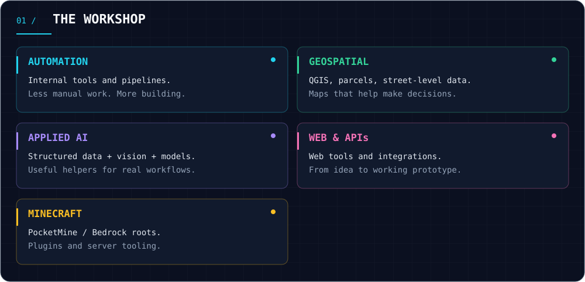
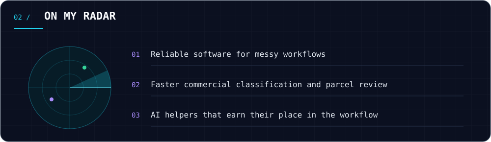
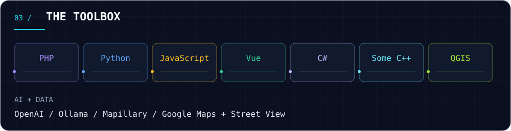
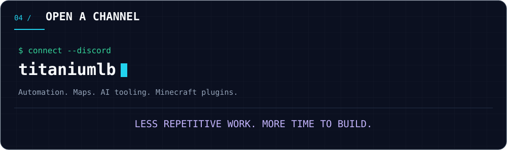

### I turn repetitive work into software that gets it done.

Automation · Geospatial tools · Applied AI · Web development

## 01 / The workshop

I build practical tools for messy, real-world workflows: automating the boring parts, making sense of geospatial data, and putting AI to work where it actually helps.

My roots are in **PHP and the Minecraft / PocketMine ecosystem**. These days, my work also spans Python, QGIS, JavaScript, Vue, C#, and AI pipelines.

## 02 / On my radar

## 03 / The toolbox

## 04 / Open a channel

Find me on Discord: **`titaniumlb`**

[**Explore my repositories →**](https://github.com/TitaniumLB6571?tab=repositories)

